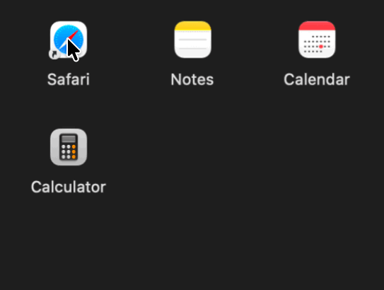

# AltHome Mac

«Пуск», панель задач и привычные сочетания клавиш для тех, кто переходит с Windows на Mac. У каждого окна своя кнопка. Наведите курсор, чтобы увидеть превью, или задержите файл над кнопкой, чтобы перенести его в свёрнутое окно.

**[Скачать для Apple Silicon](https://github.com/plakapenka/AltHome-Mac/releases/latest)** · macOS 13 и новее · На русском

| Собрать программы в папку в «Пуске» | Перетащить файл в свёрнутое окно |
| --- | --- |
|  |  |

## Установка

Распакуйте ZIP, перенесите **AltHome Mac.app** в «Программы» и запустите. Для управления окнами разрешите приложению «Универсальный доступ» в системных настройках macOS.

[Все функции, настройки и демонстрации](docs/guide.md) · [Лицензия MIT](LICENSE)
