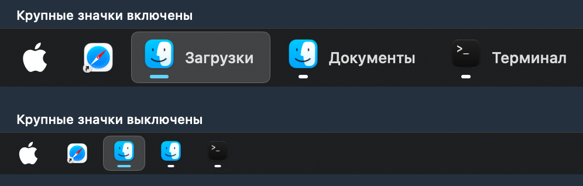
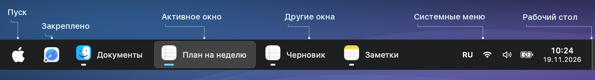
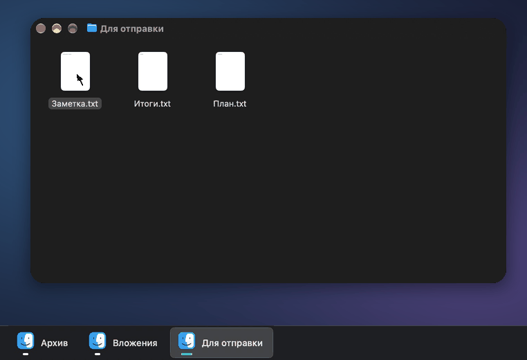
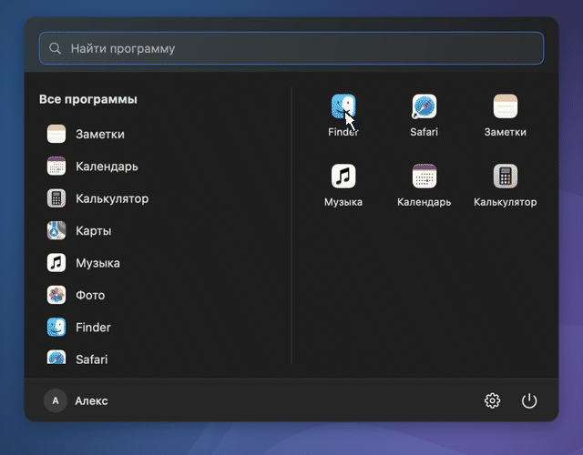
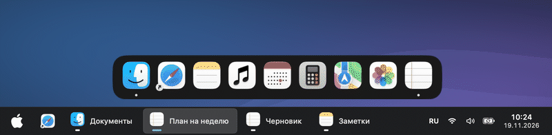
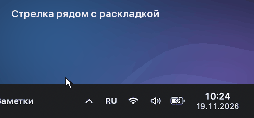

# AltHome Mac


**AltHome Mac помогает перейти с Windows на Mac и сохранить привычные способы работы.** Нажмите , чтобы найти программу в «Пуске». Переключайтесь между отдельными окнами по кнопкам на панели, перетаскивайте файлы в свёрнутые приложения и снимайте область экрана в буфер обмена. Панель, Dock и сочетания клавиш можно настроить отдельно.

[Скачать для Mac с Apple Silicon](https://github.com/plakapenka/AltHome-Mac/releases/latest) · macOS 13 и новее · Интерфейс на русском

[Окна на панели](#окна-на-панели) · [Пуск](#пуск) · [Dock](#dock) · [Системные меню](#системные-меню) · [Установка](#установка)

## Что нового

С версии **1.108** TaskShelf называется **AltHome Mac**. AltHome — общее имя проекта, а Mac обозначает платформу. При обновлении завершите TaskShelf и установите AltHome Mac в ту же папку «Программы». Приложение использует прежние настройки и закрепления. После проверки новой версии старую копию можно убрать.

- **Окна с подписями или только значки.** Можно оставить обычную высоту панели и убрать заголовки либо включить компактную панель с подписями. Ниже показаны все четыре сочетания. [Сравнить варианты](#окна-на-панели)
- **Папки в «Пуске».** Подержите одну закреплённую программу над другой до появления обводки. Папку можно назвать, а программы внутри — переставлять и запускать. [Посмотреть жест на GIF](#пуск)
- **Снимок экрана по ⌥⇧S.** Включите сочетание в основных настройках, выделите область и вставьте снимок через ⌘V. На русской раскладке работают те же физические клавиши. [Настроить сочетание](#снимок-области-в-буфер-обмена)
- **Оформление и системные меню.** Панель и «Пуск» получили общий прозрачный фон с размытием. На macOS 26 и новее меню беспроводных подключений, календарь и сетка фоновых приложений используют Liquid Glass. По правому клику на свободном месте панели «Диспетчер задач» открывает «Мониторинг системы». [Посмотреть меню](#системные-меню)

## Окна на панели

По умолчанию панель расположена снизу. Чтобы перенести её наверх, нажмите правой кнопкой по свободному месту панели и выберите **«Настройки AltHome Mac → Основные → Положение панели → Сверху»**. «Пуск», календарь, системные меню и превью окон будут открываться вниз. Выбор сохраняется после перезапуска.

В **«Настройки AltHome Mac → Основные»** доступны два независимых переключателя. **«Крупные значки»** показывает значки приложений размером 30 пт и заголовки окон. Выключите его для значков размером 28 пт без подписей. **«Компактная панель»** уменьшает высоту панели с 50 до 36 пт при любом размере значков. У каждого окна своя кнопка во всех четырёх сочетаниях.



Там же можно включить **«Прозрачный фон с размытием»**. У панели и меню «Пуск» появится полупрозрачный графитовый фон с мелкой текстурой. Его оттенок зависит от обоев или окна позади. Выключите переключатель, чтобы вернуть обоим сплошной фон. Такой же фон используется при включённом уменьшении прозрачности в macOS.



**У каждого открытого окна есть своя кнопка.** У активного окна подсвечен фон, под значком видна голубая черта. Короткая белая черта отмечает окно в фоне. В режиме крупных значков ширина кнопки зависит от заголовка. Когда приложение сообщает macOS об открытии, закрытии или переименовании окна, панель сразу обновляет его кнопку. Для приложений, которые пропускают такие события, предусмотрена периодическая сверка.

### Переключить, свернуть, закрыть

1. Нажмите кнопку окна в фоне, чтобы вывести его вперёд. Клик по уже активному окну сворачивает его. Следующий клик возвращает окно.
2. Задержите курсор над кнопкой, чтобы увидеть миниатюру. Снимок заполняет карточку с сохранением пропорций. У высокого окна видна верхняя часть, включая вкладки браузера, а у широкого — центральная часть по горизонтали. Крестик в правом верхнем углу карточки закрывает это окно.
3. По правому клику доступны **«Закрыть окно»** и, для окон с изменяемым размером, **«Развернуть / вернуть размер»**. Развёрнутое таким способом окно оставляет место для панели. Когда двойной клик по заголовку разворачивает окно по высоте экрана, AltHome Mac оставляет место для панели и закреплённого Dock. Также проверяется размер развёрнутого окна при его повторном открытии и после выхода из полноэкранного режима. Повторный двойной клик возвращает прежний размер.


### Перенести файл через панель

Возьмите файл в Finder и, удерживая кнопку мыши, задержитесь примерно на полсекунды над кнопкой нужного окна в AltHome Mac. Окно выйдет вперёд, даже если было свёрнуто. Переведите курсор внутрь окна и отпустите файл там, где приложение принимает вложения. Например, в Telegram это область открытого чата.



Можно перенести сразу несколько файлов. На второй анимации курсор проходит мимо «Вложений» и задерживается над «Архивом». Открывается выбранная папка, и в неё попадают оба документа.


### Переставить окна на панели

Зажмите кнопку окна и потяните её влево или вправо. Кнопка движется за курсором с непрозрачным фоном, поэтому её заголовок остаётся читаемым, когда соседние кнопки сдвигаются. На GIF «План на неделю» проходит через «Черновик» и «Заметки» и после отпускания остаётся справа.


### Закрепить приложение и показать рабочий стол

**Правый клик по кнопке → «Закрепить».** Когда закроется последнее окно приложения, на панели останется компактный значок. Клик по нему снова откроет приложение. Чтобы закрепить программу, которая сейчас закрыта, нажмите правой кнопкой по пустому месту панели и выберите **«Закрепить приложение…»**.

**Тонкая вертикальная черта справа от часов** отмечает кнопку «Показать рабочий стол». При наведении подсвечивается узкая область между чертой и краем экрана. Клик показывает рабочий стол. Нажмите на неё ещё раз, чтобы вернуть окна, которые свернул этот клик. Окна, свёрнутые раньше, останутся свёрнутыми. Если вы показываете рабочий стол кликом по обоям macOS, панель остаётся на выбранном краю экрана.


## Пуск

Кнопка **** открывает «Пуск» с курсором в строке поиска. Сразу вводите название программы. Слева — список программ, справа — закреплённые. Клик запускает программу, правый клик позволяет закрепить или открепить её.

Перетащите закреплённую программу на новое место, в том числе в другой ряд. Во время перетаскивания у значка и подписи общий непрозрачный фон. Соседние значки плавно сдвигаются. Отпустите программу в сетке, чтобы сохранить порядок, или за её пределами, чтобы вернуть значок на прежнее место.



Чтобы создать **папку**, перетащите закреплённую программу на значок другой и задержитесь, пока не появится цветная обводка. Отпустите кнопку мыши. Тем же жестом можно добавить программу в существующую папку. Быстрый перенос меняет порядок. Через правый клик доступна команда «Объединить в папку с».

При нажатии папка плавно раскрывается из своего значка. Стрелка «Назад» сворачивает её обратно к значку и сохраняет место в списке. При включённом в macOS уменьшении движения используется короткое затухание. Карандаш рядом с названием позволяет её переименовать. Внутри можно запускать и переставлять программы. В меню правого клика выберите «Вынести из папки», чтобы вернуть программу в сетку, или «Расформировать папку», чтобы вернуть сразу все её программы. Если внутри останется один значок, он займёт место папки.


Внизу меню имя пользователя открывает команды **блокировки экрана и выхода из сеанса**. Шестерёнка ведёт в системные настройки macOS. В меню питания находятся сон, перезапуск и выключение.

В списке «Все программы» нажмите правой кнопкой на приложение и выберите **«Удалить»**. Проверьте путь в окне подтверждения и нажмите «В Корзину». Открытое приложение сначала нужно завершить. Если прав для удаления не хватает, AltHome Mac передаст запрос Finder. macOS может попросить разрешение на управление Finder или подтверждение администратора.

## Dock

В разделе **«Настройки AltHome Mac → Dock»** есть три режима.

| Режим | Поведение |
| --- | --- |
| **Системный** | Панель задач работает рядом с обычным Dock macOS. |
| **Dock AltHome Mac** | Dock раскрывается в сторону рабочего стола. Его можно закрепить или вызвать наведением на нижнюю кромку панели по центру. |
| **Скрыть оба** | Внизу остаётся только панель задач. |

В Dock AltHome Mac значки увеличиваются рядом с курсором, а рядом появляется название приложения. Клик открывает приложение, горизонтальное перетаскивание меняет порядок. Ползунок **«Размер значков»** задаёт обычный размер от 16 до 128 пт с шагом в один пункт. Если включено **«Увеличение при наведении»**, ползунок **«Увеличение»** задаёт размер под курсором в процентах от обычного. Например, 150 % увеличивает значок в полтора раза. Изменения сразу видны в Dock.



## Системные меню

Нажмите на значок справа. Меню откроется рядом с ним со стороны рабочего стола и закроется по клику снаружи.


| Куда нажать | Что можно сделать |
| --- | --- |
| **Wi-Fi** | Полоски на панели показывают силу сигнала. Восклицательный знак означает, что Wi-Fi включён без подключения к сети, а перечёркнутый значок — что Wi-Fi выключен. В меню можно включить Wi-Fi, посмотреть название сети и выбрать другую. В macOS 26 и новее окно использует системный Liquid Glass. Вверху — вкладки Wi-Fi, Bluetooth и AirDrop со значками. При переключении подсветка плавно переходит к выбранной вкладке. |
| **Bluetooth и AirDrop** | Переключить Bluetooth и посмотреть подключённые устройства. Из AirDrop можно открыть передачу файлов в Finder или настройки приёма. |
| **Звук** | Изменить громкость или выбрать устройство вывода. В macOS 26 и новее окно использует системный материал Liquid Glass. Ползунок выше нуля включает звук. Число волн на динамике в окне и на панели меняется вместе с громкостью. При выключенном звуке динамик перечёркнут. |
| **Аккумулятор** | Посмотреть заряд и источник питания, включить энергосбережение, изменить яркость поддерживаемого дисплея. |
| **Часы** | Открыть календарь с системным эффектом Liquid Glass на macOS 26 и новее, посмотреть время с секундами, перейти к другому месяцу или вернуться к сегодняшней дате. |
| **Раскладка и стрелка ⌃** | Нажать на код языка для смены раскладки. Под стрелкой собраны доступные значки приложений из строки меню. |

### Переключение языка с клавиатуры

Откройте **«Настройки AltHome Mac → Основные → Переключение языка»**. Выберите **«⌘ Command + Shift»**. Если в macOS клавиши Command и Control поменяны местами, выберите **«⌃ Control + Shift»**, чтобы переключать язык физической клавишей ⌘. Нажмите обе клавиши и отпустите. Сочетания с третьей клавишей выполняют обычные команды приложения.

Выберите **«Как в macOS»**, чтобы сразу вернуться к штатному переключению.

### Снимок области в буфер обмена

В **«Настройки AltHome Mac → Основные»** включите **«Снимок области по ⌥ Option + ⇧ Shift + S»**. Нажмите сочетание и выделите прямоугольник мышью. Вставьте снимок через **⌘V**. Клавиша **Esc** отменяет выделение. На русской раскладке используйте те же физические клавиши — **⌥ + ⇧ + Ы**.

### Буквенные сочетания с Fn

В **«Настройки AltHome Mac → Основные»** включите **«Fn как ⌘ для букв»**. **Fn+C** копирует выделенное, **Fn+V** вставляет, **Fn+Z** отменяет последнее действие. Клавиши с латинскими буквами работают и в русской раскладке. Можно добавить Shift, например **Fn+Shift+Z** для повтора действия в приложениях, где оно назначено на ⌘+Shift+Z.

Одиночный Fn, стрелки и функциональный ряд сохраняют свои действия. Выключите опцию, чтобы вернуть системные сочетания Fn с буквами.

### Приложения под стрелкой

Нажмите **⌃** рядом с индикатором раскладки. Стрелка повернётся, и со стороны рабочего стола выдвинется сетка цветных значков приложений из строки меню macOS. На macOS 26 и новее у окна системный фон Liquid Glass, на более ранних версиях — полупрозрачный фон с размытием. Подведите курсор к значку, чтобы подсветить его. Левый клик открывает значок, правый — контекстное меню рядом с ним. В нём доступны команды, которые приложение передаёт macOS, а также действия «Показать в Finder» и «Завершить приложение». Для значков, которые создают меню только при нажатии, выберите «Открыть меню значка». Клик вне сетки закрывает её.



### Меню аккумулятора

Клик по батарее открывает окно рядом с панелью. В macOS 26 и новее у него та же поверхность Liquid Glass, что и у окна звука. Вверху видны заряд и источник питания, ниже находятся ползунок яркости и переключатель энергосбережения. На самой панели уровень заряда виден по заполнению значка, а при питании от сети внутри появляется молния.


### Верхняя строка меню macOS

В **«Настройки AltHome Mac → Основные»** включите **«Блокировать строку меню при наведении»**. Для работы на рабочем столе и в полноэкранных приложениях в настройках строки меню macOS выберите автоскрытие **«Всегда»** и предоставьте AltHome Mac «Универсальный доступ».

Пока AltHome Mac работает, наведение на внешний верхний край блокируется до того, как macOS раскроет скрытую строку меню. Строку меню по-прежнему можно вызвать с клавиатуры. На общей границе двух мониторов, расположенных друг над другом, указатель свободно переходит между ними. Выключите переключатель, чтобы вернуть обычное наведение.


## Установка

Скачайте ZIP из раздела [Releases](https://github.com/plakapenka/AltHome-Mac/releases/latest), распакуйте его и перенесите **AltHome Mac.app** в папку «Программы». Для управления окнами разрешите AltHome Mac «Универсальный доступ» в системных настройках macOS.

Для сборки нужны инструменты разработчика Apple с компилятором Swift и актуальным macOS SDK. Запустите сборку и откройте приложение из каталога репозитория.

```sh
bash build.sh
open "AltHome Mac.app"
```

Скрипт создаст **AltHome Mac.app** рядом с исходниками. Для постоянной установки перенесите приложение в папку «Программы» и запускайте его оттуда. Автозапуск включается в **«Настройки AltHome Mac → Основные → Запускать при входе»**.

**Настройки самой панели** открываются правым кликом по свободному месту → **«Настройки AltHome Mac…»**. Пункт **«Диспетчер задач»** в этом меню открывает «Мониторинг системы» macOS. Здесь же можно завершить работу панели.


<details>
<summary>Какие разрешения нужны для отдельных функций</summary>

- **Универсальный доступ** — управление отдельными окнами и чтение значков системного Dock. В основных настройках AltHome Mac выберите «Управление окнами».
- **Запись экрана** — изображение в миниатюре при наведении. Запрос открывается из пункта «Превью окон».
- **Геолокация** — названия ближайших сетей Wi-Fi. Нажмите «Разрешить доступ» в меню Wi-Fi.
- **Bluetooth** — сведения о подключённых устройствах.

При самостоятельных обновлениях используйте одну и ту же подпись, чтобы macOS узнавала приложение. Скрипт выбирает сертификат Apple Development, если он один. Выбрать другую подпись можно через `ALTHOME_SIGN_IDENTITY`.

</details>

На скриншотах и GIF показан интерфейс AltHome Mac с демонстрационными окнами, приложениями и сетями. [Подробная инструкция](Прочти.txt) · [История изменений](https://github.com/plakapenka/AltHome-Mac/commits/main/)

## Лицензия

AltHome Mac распространяется по [лицензии MIT](LICENSE). © 2026 plakapenka.
