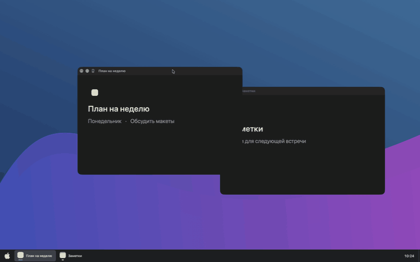
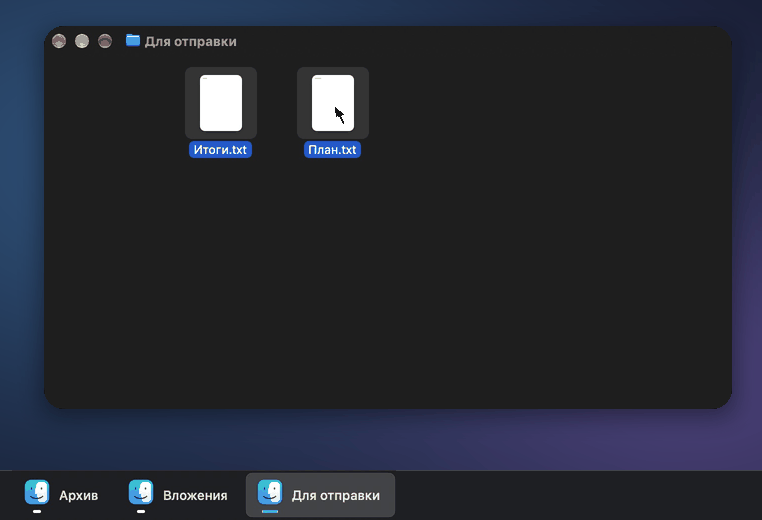
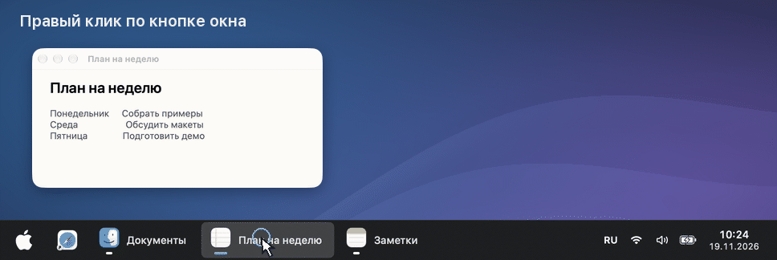
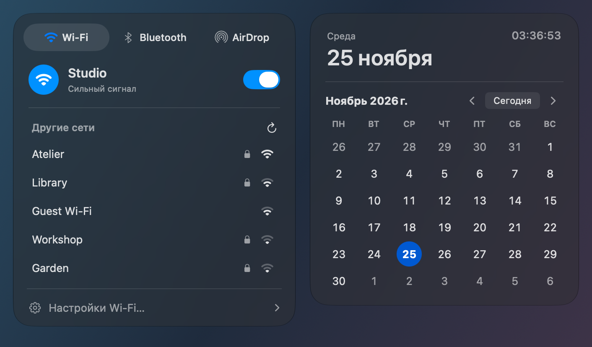
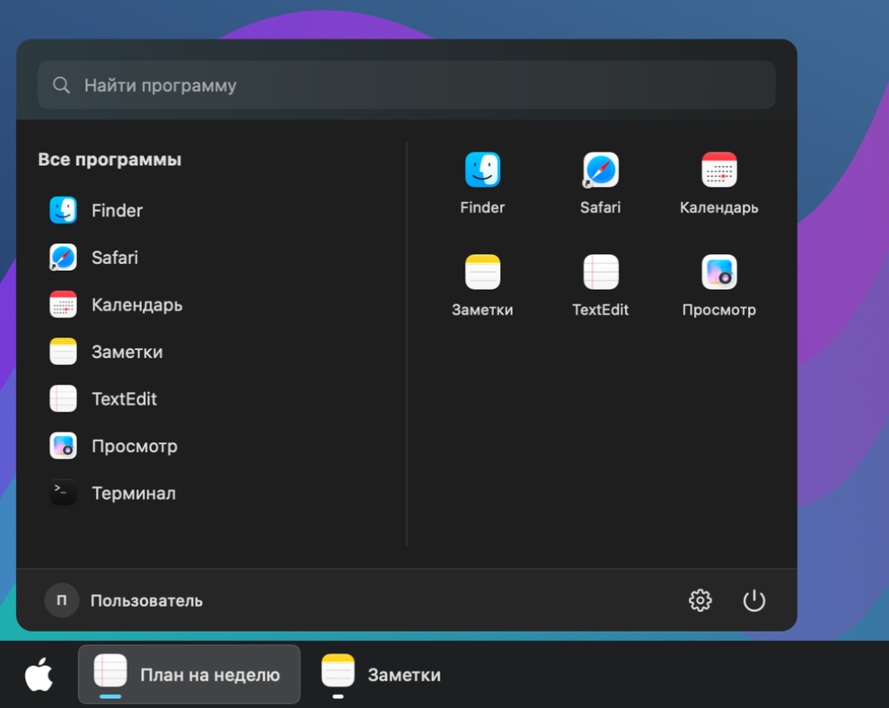
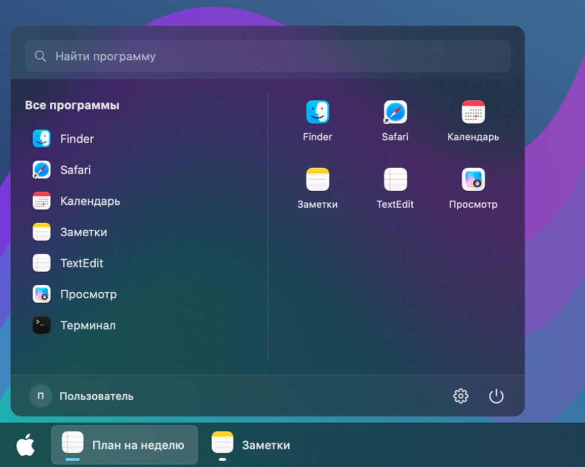

# AltHome Mac

«Пуск», панель задач и привычные сочетания клавиш для тех, кто переходит с Windows на Mac. У каждого окна своя кнопка. Наведите курсор, чтобы увидеть превью, или задержите файл над кнопкой, чтобы перенести его в свёрнутое окно.

**[Скачать для Apple Silicon](https://github.com/plakapenka/AltHome-Mac/releases/latest)** · macOS 13 и новее · На русском

## Панель задач

Потяните окно за заголовок к левому или правому краю, затем выберите второе окно для соседней половины. Верхний край разворачивает окно до панели.

Размер значков и высота панели

Кнопки панели. Справа подсвечена область «Показать рабочий стол».

Свернуть, вернуть или закрыть окно

Перетащить файл в свёрнутое окно

Перенести несколько файлов сразу

Изменить порядок окон

Закрепить приложение и показать рабочий стол

## Пуск и Dock

Переставить закреплённые программы

Собрать программы в папку

Увеличение значков Dock при наведении

## Системные меню

Wi-Fi и календарь

Фоновые приложения под стрелкой

Заряд, яркость и энергосбережение

## Настройки

«Основные» → «Прозрачный фон с размытием» меняет оформление панели и «Пуска».

| Сплошной фон | С размытием |
| --- | --- |
|  |  |

Сочетания клавиш и верхняя строка меню

Размер и увеличение значков Dock

## Установка

Распакуйте ZIP, перенесите **AltHome Mac.app** в «Программы» и запустите. Для управления окнами разрешите приложению «Универсальный доступ» в системных настройках macOS.

[Все функции, настройки и демонстрации](docs/guide.md) · [Лицензия MIT](LICENSE)
