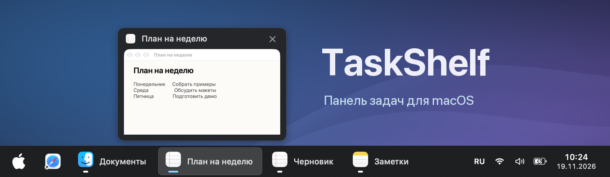
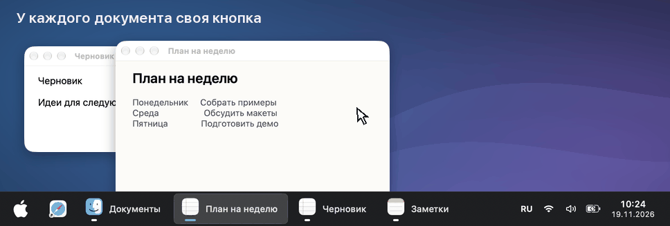
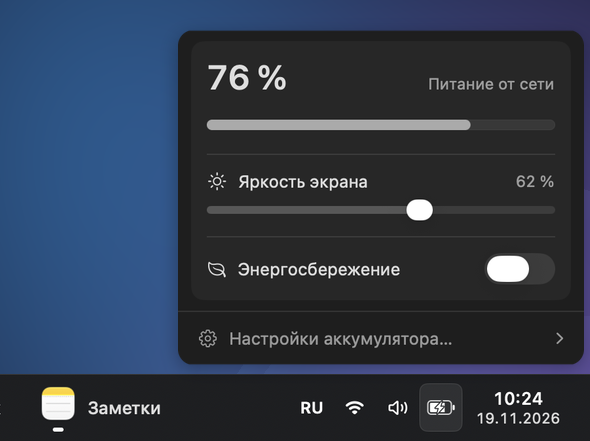
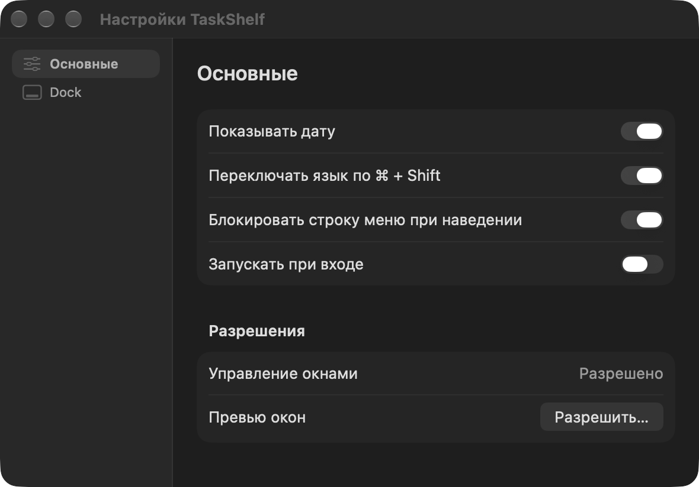
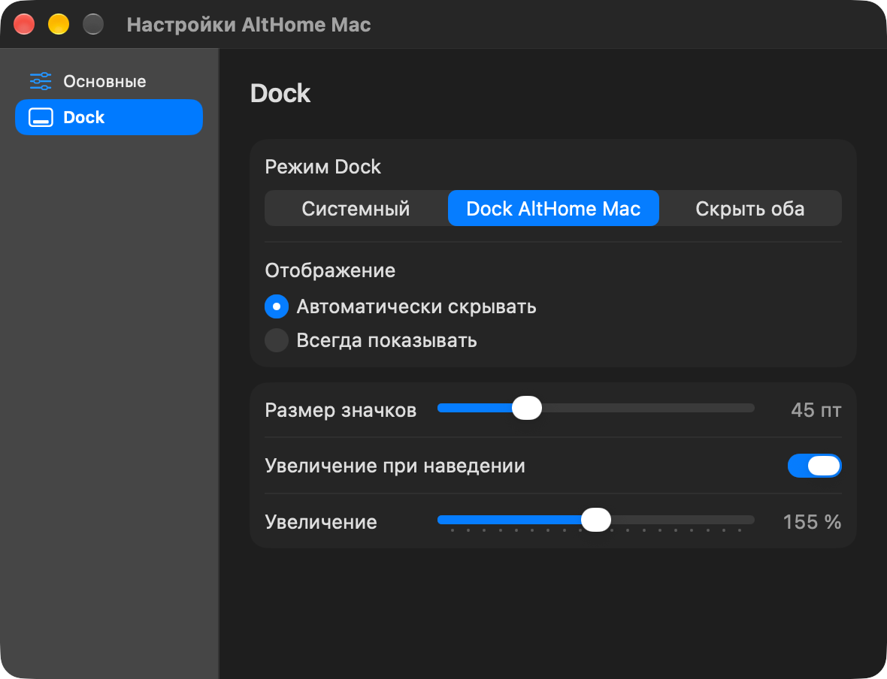

# TaskShelf



**TaskShelf — панель задач для Mac в стиле Windows 11.** У каждого окна своя кнопка. Наведите курсор, чтобы увидеть превью, или нажмите, чтобы переключиться на окно. В меню «Пуск» можно найти программу и закрепить её для быстрого доступа.

[Скачать для Mac с Apple Silicon](https://github.com/plakapenka/TaskShelf/releases/latest) · macOS 13 и новее · Интерфейс на русском

[Окна на панели](#окна-на-панели) · [Пуск](#пуск) · [Dock](#dock) · [Системные меню](#системные-меню) · [Установка](#установка)

## Окна на панели


**Кнопка с названием — открытое окно.** У активного окна подсвечен фон, под значком видна голубая черта. Короткая белая черта отмечает окно в фоне. Ширина кнопки зависит от заголовка. Когда приложение сообщает macOS об открытии, закрытии или переименовании окна, панель сразу обновляет его кнопку. Для приложений, которые пропускают такие события, предусмотрена периодическая сверка.

### Переключить, свернуть, закрыть

1. Нажмите кнопку окна в фоне, чтобы вывести его вперёд. Клик по уже активному окну сворачивает его. Следующий клик возвращает окно.
2. Задержите курсор над кнопкой, чтобы увидеть миниатюру. Снимок заполняет карточку с сохранением пропорций. У высокого окна видна верхняя часть, включая вкладки браузера, а у широкого — центральная часть по горизонтали. Крестик в правом верхнем углу карточки закрывает это окно.
3. По правому клику доступны **«Закрыть окно»** и, для окон с изменяемым размером, **«Развернуть / вернуть размер»**. Развёрнутое таким способом окно оставляет место для панели. Когда двойной клик по заголовку разворачивает окно до нижнего края экрана, TaskShelf оставляет место для панели и закреплённого Dock. Это работает и с собственными заголовками браузеров. Повторный двойной клик возвращает прежний размер.



### Перенести файл через панель

Возьмите файл в Finder и, удерживая кнопку мыши, задержитесь примерно на полсекунды над кнопкой нужного окна в TaskShelf. Окно выйдет вперёд, даже если было свёрнуто. Переведите курсор внутрь окна и отпустите файл там, где приложение принимает вложения. Например, в Telegram это область открытого чата.


Можно перенести сразу несколько файлов. На второй анимации курсор проходит мимо «Вложений» и задерживается над «Архивом». Открывается выбранная папка, и в неё попадают оба документа.


### Переставить окна на панели

Зажмите кнопку окна и потяните её влево или вправо. Кнопка движется за курсором с непрозрачным фоном, поэтому её заголовок остаётся читаемым, когда соседние кнопки сдвигаются. На GIF «План на неделю» проходит через «Черновик» и «Заметки» и после отпускания остаётся справа.


### Закрепить приложение и показать рабочий стол

**Правый клик по кнопке → «Закрепить».** Когда закроется последнее окно приложения, на панели останется компактный значок. Клик по нему снова откроет приложение. Чтобы закрепить программу, которая сейчас закрыта, нажмите правой кнопкой по пустому месту панели и выберите **«Закрепить приложение…»**.

**Узкая область справа от часов** показывает рабочий стол. Нажмите на неё ещё раз, чтобы вернуть окна, которые свернул этот клик. Окна, свёрнутые раньше, останутся свёрнутыми.


## Пуск

Кнопка **** открывает «Пуск» с курсором в строке поиска. Сразу вводите название программы. Слева — список программ, справа — закреплённые. Клик запускает программу, правый клик позволяет закрепить или открепить её.

Перетащите закреплённую программу на новое место, в том числе в другой ряд. Во время перетаскивания у значка и подписи общий непрозрачный фон. Соседние значки плавно сдвигаются. Отпустите программу в сетке, чтобы сохранить порядок, или за её пределами, чтобы вернуть значок на прежнее место.


Внизу меню имя пользователя открывает команды **блокировки экрана и выхода из сеанса**. Шестерёнка ведёт в системные настройки macOS. В меню питания находятся сон, перезапуск и выключение.

## Dock

В разделе **«Настройки TaskShelf → Dock»** есть три режима.

| Режим | Поведение |
| --- | --- |
| **Системный** | Панель задач работает рядом с обычным Dock macOS. |
| **Dock TaskShelf** | Значки Dock появляются над панелью. Dock можно закрепить или вызывать наведением на нижний край экрана по центру. |
| **Скрыть оба** | Внизу остаётся только панель задач. |

В Dock TaskShelf значки увеличиваются рядом с курсором, а сверху появляется название приложения. Клик открывает приложение, горизонтальное перетаскивание меняет порядок. Ползунок **«Размер значков»** задаёт обычный размер от 16 до 128 пт с шагом в один пункт. Если включено **«Увеличение при наведении»**, ползунок **«Увеличение»** задаёт размер под курсором в процентах от обычного. Например, 150 % увеличивает значок в полтора раза. Изменения сразу видны в Dock.

В списке «Все программы» нажмите правой кнопкой на приложение и выберите **«Удалить»**. Проверьте путь в окне подтверждения и нажмите «В Корзину». Открытое приложение сначала нужно завершить. Если прав для удаления не хватает, TaskShelf передаст запрос Finder. macOS может попросить разрешение на управление Finder или подтверждение администратора.


## Системные меню

Нажмите на значок справа. Меню откроется прямо над ним и закроется по клику снаружи.


| Куда нажать | Что можно сделать |
| --- | --- |
| **Wi-Fi** | Включить Wi-Fi, увидеть название текущей сети, сравнить уровень сигнала и подключиться к другой сети. На соседних вкладках — Bluetooth и AirDrop. |
| **Bluetooth и AirDrop** | Переключить Bluetooth и посмотреть подключённые устройства. Из AirDrop можно открыть передачу файлов в Finder или настройки приёма. |
| **Звук** | Изменить громкость или выбрать устройство вывода. |
| **Аккумулятор** | Посмотреть заряд и источник питания, включить энергосбережение, изменить яркость поддерживаемого дисплея. |
| **Часы** | Открыть календарь, посмотреть время с секундами, перейти к другому месяцу или вернуться к сегодняшней дате. |
| **Раскладка и стрелка ⌃** | Нажать на код языка для смены раскладки. Под стрелкой собраны доступные значки приложений из строки меню. |

### Переключение языка с клавиатуры

Откройте **«Настройки TaskShelf → Основные → Переключение языка»**. Выберите **«⌘ Command + Shift»**. Если в macOS клавиши Command и Control поменяны местами, выберите **«⌃ Control + Shift»**, чтобы переключать язык физической клавишей ⌘. Нажмите обе клавиши и отпустите. Сочетания с третьей клавишей выполняют обычные команды приложения.

Выберите **«Как в macOS»**, чтобы сразу вернуться к штатному переключению.

### Буквенные сочетания с Fn

В **«Настройки TaskShelf → Основные»** включите **«Fn как ⌘ для букв»**. **Fn+C** копирует выделенное, **Fn+V** вставляет, **Fn+Z** отменяет последнее действие. Клавиши с латинскими буквами работают и в русской раскладке. Можно добавить Shift, например **Fn+Shift+Z** для повтора действия в приложениях, где оно назначено на ⌘+Shift+Z.

Одиночный Fn, стрелки и функциональный ряд сохраняют свои действия. Выключите опцию, чтобы вернуть системные сочетания Fn с буквами.

### Приложения под стрелкой

Нажмите **⌃** рядом с индикатором раскладки. Над стрелкой откроется сетка цветных значков приложений, у которых есть пункт в строке меню macOS. Подведите курсор к значку, чтобы подсветить его. Клик по значку открывает меню приложения, клик вне сетки закрывает её.


### Меню аккумулятора

Клик по батарее открывает окно над панелью. Вверху видны заряд и источник питания, ниже находятся ползунок яркости и переключатель энергосбережения. На самой панели уровень заряда виден по заполнению значка, а при питании от сети внутри появляется молния.



### Верхняя строка меню macOS

В **«Настройки TaskShelf → Основные»** включите **«Блокировать строку меню при наведении»**. Для работы на рабочем столе и в полноэкранных приложениях в настройках строки меню macOS выберите автоскрытие **«Всегда»** и предоставьте TaskShelf «Универсальный доступ».

Пока TaskShelf работает, наведение на внешний верхний край блокируется до того, как macOS раскроет скрытую строку меню. Строку меню по-прежнему можно вызвать с клавиатуры. На общей границе двух мониторов, расположенных друг над другом, указатель свободно переходит между ними. Выключите переключатель, чтобы вернуть обычное наведение.



## Установка

Скачайте ZIP из раздела [Releases](https://github.com/plakapenka/TaskShelf/releases/latest), распакуйте его и перенесите **TaskShelf.app** в папку «Программы». Для управления окнами разрешите TaskShelf «Универсальный доступ» в системных настройках macOS.

Для сборки нужны инструменты разработчика Apple с компилятором Swift и актуальным macOS SDK. Запустите сборку и откройте приложение из каталога репозитория.

```sh
bash build.sh
open TaskShelf.app
```

Скрипт создаст **TaskShelf.app** рядом с исходниками. Для постоянной установки перенесите приложение в папку «Программы» и запускайте его оттуда. Автозапуск включается в **«Настройки TaskShelf → Основные → Запускать при входе»**.

**Настройки самой панели** открываются правым кликом по свободному месту → **«Настройки TaskShelf…»**. Там же, в контекстном меню, можно завершить работу панели.



<details>
<summary>Какие разрешения нужны для отдельных функций</summary>

- **Универсальный доступ** — управление отдельными окнами и чтение значков системного Dock. В основных настройках TaskShelf выберите «Управление окнами».
- **Запись экрана** — изображение в миниатюре при наведении. Запрос открывается из пункта «Превью окон».
- **Геолокация** — названия ближайших сетей Wi-Fi. Нажмите «Разрешить доступ» в меню Wi-Fi.
- **Bluetooth** — сведения о подключённых устройствах.

При самостоятельных обновлениях используйте одну и ту же подпись, чтобы macOS узнавала приложение. Скрипт выбирает сертификат Apple Development, если он один. Выбрать другую подпись можно через `TASKSHELF_SIGN_IDENTITY`.

</details>

Скриншоты и GIF собраны из интерфейса TaskShelf 1.63–1.74 с демонстрационными окнами, приложениями и сетями. [Подробная инструкция](Прочти.txt) · [История изменений](https://github.com/plakapenka/TaskShelf/commits/main/)

## Лицензия

TaskShelf распространяется по [лицензии MIT](LICENSE). © 2026 plakapenka.
